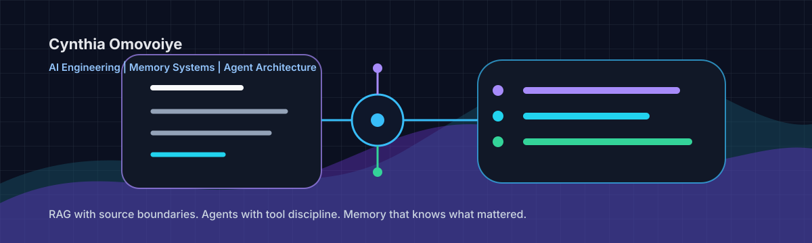

<p align="center">
  
</p>

# Cynthia Omovoiye

AI Engineer building practical LLM systems with stronger memory, cleaner retrieval, better source boundaries, and safer agent behavior. Currently building [Recall Lab](https://github.com/CynthiaOmovoiye/recall-lab), a research repo for testing memory strategies in long-running LLM agents.

I have 5+ years of software engineering experience across backend, frontend, mobile, and technical leadership. My current work sits at the edge of AI engineering and cognitive architecture: RAG, agent workflows, memory systems, hallucination restraint, context engineering, and evals.

My first degree is in History and International Studies. That lens still shows up in my work. I care about memory, continuity, evidence, source quality, and how systems carry meaning across time.

<p>
  <a href="https://cynthia-omovoiye-portfolio.netlify.app/"></a>
  <a href="https://github.com/CynthiaOmovoiye/recall-lab"></a>
  <a href="https://www.linkedin.com/in/cynthia-omovoiye-469568184/"></a>
  <a href="mailto:omovoiye@gmail.com"></a>
</p>

## Current Focus

```txt
Memory engineering     RAG systems             Agent architecture
Context engineering    Model evaluation        Hallucination restraint
Tool boundaries        Source grounding        Practical LLM products
```

<!-- | [DocBase](https://github.com/CynthiaOmovoiye/docubase) | Engineering memory layer for repos, portfolios, resumes, and grounded AI twins. | -->

## Featured Work

| Project | What it proves |
|---|---|
| [Recall Lab](https://github.com/CynthiaOmovoiye/recall-lab) | Research repo testing whether selective forgetting improves long-running agent coherence. |
| [Meridian Support Bot](https://github.com/CynthiaOmovoiye/meridian-support-bot) | Customer support agent with RAG, policy boundaries, authenticated workflows, and guardrails. |
| [LLM Benchmark Dashboard](https://github.com/CynthiaOmovoiye/llm-benchmark-dashboard) | Evaluation surface for comparing model behavior, latency, cost, and output quality. |

## Recall Lab

My main research repo is [Recall Lab](https://github.com/CynthiaOmovoiye/recall-lab).

It asks one practical question:

> How do we build LLM systems that remember the right things, forget noise, admit uncertainty, and stay grounded over long interactions?

The working hypothesis:

> Coherence over hundreds of turns may depend more on selective forgetting than larger context windows.

The experiment compares memory strategies across long conversations:

| Agent | Memory strategy |
|---|---|
| Sliding window agent | Keeps only the latest turns. |
| Vector retrieval agent | Retrieves semantically similar past turns. |
| Consolidated memory agent | Reads a living memory brief before each response. |
| Sleep job agent | Scores salience, compresses high-salience events, and keeps low-salience noise out of the prompt. |

The evaluation tracks recall accuracy, token cost, hallucination rate, failure modes, and whether the agent admits uncertainty.

This is part of a broader research track around structured cognitive memory for LLM systems:

| Layer | Engineering role |
|---|---|
| Working memory | What the model needs for the current turn. |
| Episodic memory | Past events, sessions, decisions, and corrections. |
| Semantic memory | Stable facts, concepts, and user-approved knowledge. |
| Procedural memory | How the system performs tasks. |
| Correction memory | Mistakes the system should avoid repeating. |
| Known limits memory | What the system should defer, verify, or refuse. |
| Metacognitive check | Decide whether to answer, verify, defer, or say "I do not know." |

## Stack

<p>
  
  
  
  
  
  
  
  
  
  
  
  
</p>

## How I Think About AI Systems

- Fine-tuning shapes behavior.
- Retrieval supplies knowledge.
- Memory preserves continuity.
- Evaluation enforces truthfulness.
- Context engineering decides what enters the model now.
- Memory engineering decides what remains available later.

## Profile Signals

- 50+ public repositories across AI engineering, web systems, data projects, and product experiments.
- Pinned work points toward memory systems, agent workflows, RAG, evals, MCP, and applied LLM products.
- Current research thread: [Recall Lab](https://github.com/CynthiaOmovoiye/recall-lab), a practical experiment in long-running agent memory.
- Portfolio: [cynthia-omovoiye-portfolio.netlify.app](https://cynthia-omovoiye-portfolio.netlify.app/)

## Open To

AI Engineer, Applied AI Engineer, LLM Engineer, Full Stack AI Engineer, AI Platform Engineer, and founding engineer roles where the work involves real systems, messy context, retrieval, memory, agents, evals, and product judgment.
